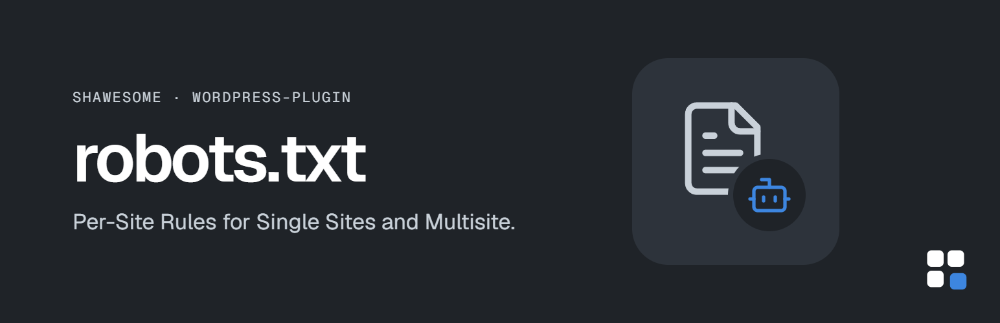

# shawesome robots.txt – Per-Site Rules for Single Sites and Multisite

Its own robots.txt for a single WordPress site or for every site of a multisite network – edited in the admin or deployed as a file.

By [shawesome](https://shawesome.de/) · Open source under the [GNU General Public License v2 or later](LICENSE).

## How it works

Each site gets its own robots.txt, resolved in this order:

1. **File** – a plain text file in `wp-content/shawesome-robots-txt/`, named after the domain (dots become hyphens). Useful for Git-based deployments.
2. **Database** – content edited under *shawesome → robots.txt* (single site) or *Network Admin → shawesome → robots.txt* (network), stored per site (survives domain changes, removed with the site).
3. **Not set** – if neither exists, WordPress and SEO plugins generate the robots.txt.

| Domain             | Override file           |
| ------------------ | ----------------------- |
| `www.example.com`  | `www-example-com.txt`   |
| `shop.example.com` | `shop-example-com.txt`  |

The domain with dots (`www.example.com.txt`) is accepted as an unambiguous alternative. While a file exists, the editor shows it read-only and can copy it into the database.

- A site gets its own robots.txt if its address has no path: single sites at the root, every site of a network with (sub)domains, and the main site and sites with their own domain in a network with subdirectories
- Sites with a path (`example.com/blog/`) in a network with subdirectories: their host's robots.txt gets `Disallow` for hidden sites and `Sitemap` for public ones (can be switched off, also applies in "Exact" mode)
- Per site: mode, Crawl-delay (off by default) and resources – CSS/JS, images and PDFs are allowed by default and blocked with Disallow lines when switched off
- Editor buttons for example rules and for a block against AI training crawlers (AI search crawlers stay allowed)
- A physical `robots.txt` in the web root is shown and can be renamed to `_old-robots.txt` (never deleted)
- Sites set to "Discourage search engines" keep the WordPress default (can be switched off)

## Yoast SEO and All in One SEO

Both plugins change the robots.txt output: Yoast SEO removes the WordPress default rules (`User-agent: *`, `Disallow: /wp-admin/`, `Allow: /wp-admin/admin-ajax.php` in exactly this order) and appends its own rules and sitemap, All in One SEO rebuilds the rules and drops comments and Sitemap lines. In the settings you choose the mode:

- **Base** (default) – the content replaces the WordPress default, SEO plugins may add to it; duplicate Sitemap lines are removed
- **Exact** – the content is delivered as is, after all SEO plugins have run; sites without a custom robots.txt (no content in the editor and no file) keep the one from WordPress and the SEO plugins

The default mode is set in the settings; each site can choose its own in its editor. In a network, the robots.txt tab lists all sites with their mode, the source of their robots.txt, the override file name, detected SEO plugins and a status (all crawlers blocked, sitemaps linked, AI training blocked, delivery problems), which is checked from the live robots.txt and kept for a configurable time.

## For developers

- Constant `SHAWESOME_ROBOTS_TXT_DIR` / filter `shawesome_robots_txt_dir` – directory for override files
- Filter `shawesome_robots_txt_candidate_files` – candidate file paths per domain
- Filter `shawesome_robots_txt_priority` – priority of the `robots_txt` filter
- Site options `shawesome_robots_txt_content`, `shawesome_robots_txt_mode`, `shawesome_robots_txt_status`, `shawesome_robots_txt_rules` – content, mode, status and options per site (not autoloaded)

## Requirements

- WordPress 7.1+ (single site or multisite)
- PHP 7.4+

The interface is in English. Translations will come from [translate.wordpress.org](https://translate.wordpress.org/) once the plugin is listed in the directory.

## Installation

Copy the folder `shawesome-robots-txt/` to `wp-content/plugins/` (or upload it as a ZIP) and activate the plugin – in a network, network-activate it. See [`readme.txt`](shawesome-robots-txt/readme.txt) for FAQ and changelog.

## Repository layout

- `shawesome-robots-txt/` – the plugin (translation template in `languages/`)
- `.wordpress-org/` – plugin directory assets (banners, icons)

## License

Copyright © shawesome.

This program is free software; you can redistribute it and/or modify it under the terms of the GNU General Public License as published by the Free Software Foundation; either version 2 of the License, or (at your option) any later version. See [LICENSE](LICENSE).
